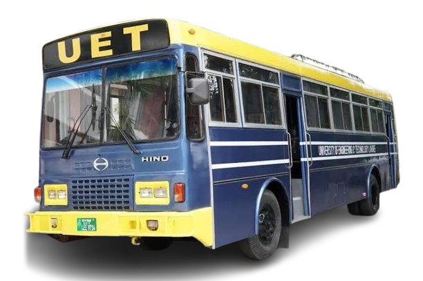
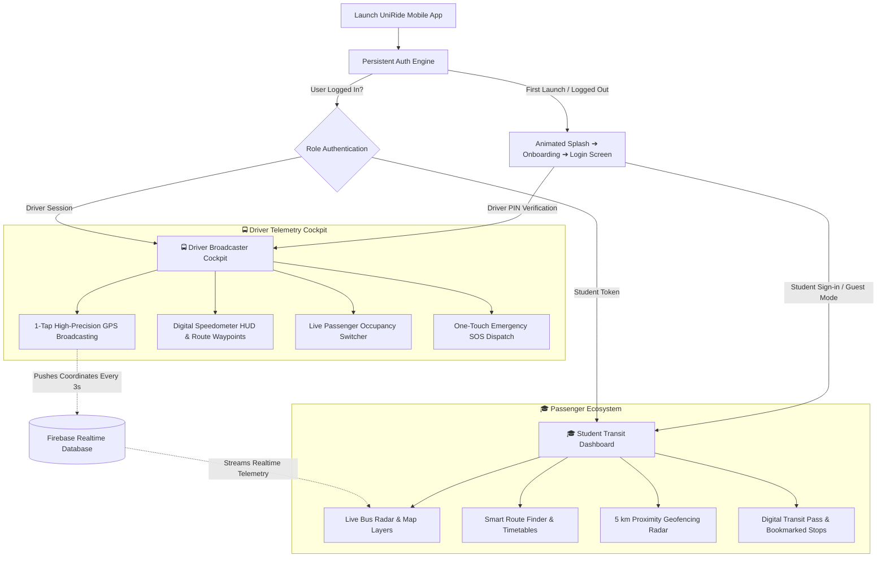

<div align="center">

  

  # 🚍 UniRide Mobile Application
  ### *Intelligent Campus Transit, Live GPS Telemetry & Passenger Radar*
  #### **University of Engineering & Technology (UET) — RCET Campus, Gujranwala**

  <p align="center">
    <b>A production-grade, dual-role Flutter mobile application built for 4,000+ university students, faculty members, and shuttle fleet drivers across Gujranwala and the GT Road transit corridor.</b>
  </p>

  <p align="center">
    <a href="https://flutter.dev"></a>
    <a href="https://dart.dev"></a>
    <a href="https://firebase.google.com"></a>
    <a href="https://www.openstreetmap.org"></a>
    <a href="https://developer.android.com"></a>
    <a href="./admin_portal/README.md"></a>
    <a href="LICENSE"></a>
  </p>

  <p align="center">
    <a href="#-executive-summary">Overview</a> •
    <a href="#-dual-role-architecture">Dual Ecosystem</a> •
    <a href="#-key-mobile-features">Features</a> •
    <a href="#-app-screens--user-journey">App Screens</a> •
    <a href="#-system-architecture">Architecture</a> •
    <a href="#-fleet--route-directory">Routes & Fleet</a> •
    <a href="#-smart-proximity-radar">Proximity Radar</a> •
    <a href="#-mobile-permissions--device-hardware">Permissions</a> •
    <a href="#-installation--build">Build & Run</a> •
    <a href="#-demo-credentials">Test Accounts</a> •
    <a href="#-companion-admin-portal">Admin Portal</a>
  </p>

  

</div>

---

> 🌐 **Looking for the Web Admin Management Portal?**  
> UniRide includes a dedicated fleet command center for university transit staff. Please see the [**UniRide Web Admin Portal Documentation (admin_portal/README.md)**](./admin_portal/README.md).

---

## 📌 Executive Summary

Navigating daily transport across the Gujranwala metropolitan division—spanning **Chanda Qila, Kangniwala, Peoples Colony, Wapda Town, Cantt, Rahwali, Ghakhar, Kamoke, and Sialkot Bypass**—presents major commuting challenges:
- High variability in GT Road morning traffic.
- Dense winter fog causing unexpected transit delays.
- Lack of live location visibility resulting in missed pickups or prolonged roadside waits.

**UniRide Mobile** eliminates these pain points with a unified Flutter application providing:
1. **Sub-second GPS Telemetry**: Real-time position tracking streamed directly over Firebase Realtime Database.
2. **Turnkey Driver Cockpit**: Transforms any standard driver smartphone into a precision GPS broadcasting node.
3. **5 km Proximity Geofencing**: Automatic background/foreground vibration and floating alerts when a bus nears the student's designated stop.
4. **Origin-Destination Journey Finder**: Instant route discovery across all 5 official campus lines.
5. **Offline Resilient Operation**: Complete fallback stop datasets and mock telemetry for zero-downtime campus usage.

---

## 🎭 Dual-Role Architecture

The UniRide mobile app operates as a **single, secure binary** that branches into two tailored experiences based on user authentication:



---

## ✨ Key Mobile Features

### 🎓 1. Student & Commuter Experience (Passenger Mode)

- **📍 Real-Time Live Bus Radar**:
  - Live tracking of all moving campus buses with 60 FPS location interpolation.
  - Real-time speedometer reading (km/h), driver name, and current stop progression.
  - Multi-layer cartography: Standard OpenStreetMap, Esri High-Resolution Satellite imagery, and Topographic terrain.
- **🔄 Origin-Destination Route Finder**:
  - Select any two points across Gujranwala (e.g., *Chanda Qila ➔ RCET Campus*).
  - Automatically identifies direct bus lines, intermediate stops, distance, and ETA.
- **🕒 Timetables & 4:15 PM Departure Schedules**:
  - Morning pickup timelines starting from 06:45 AM.
  - Official university evening departure schedules (sharp **4:15 PM** from RCET main bus bay).
- **🔔 5 km Smart Proximity Geofence Radar**:
  - Calculates real-time Haversine distance between the moving shuttle and the passenger's saved pickup location.
  - Automatically triggers floating alerts and haptic feedback when the shuttle is within 5 kilometers.
- **⭐ Saved Favorite Stops**:
  - Bookmark daily pickup spots for instant 1-tap tracking directly on the home screen.
- **🪪 Digital Campus Bus Pass & QR Code**:
  - Student identity verification screen featuring department, registration ID, semester, and scannable transit QR pass.
- **🔒 Persistent Auto-Login & OTP Registration**:
  - Biometric/credential persistence via `SharedPreferences`.
  - SHA-256 password hashing and 6-digit email OTP verification.
- **👀 Guest Mode**:
  - Instant one-tap access for prospective students, visitors, or examination candidates without registration.

---

### 🚍 2. Shuttle Fleet Driver Cockpit (Broadcaster Mode)

- **📡 One-Tap Hardware GPS Telemetry Transmission**:
  - High-frequency GPS position streaming utilizing the native `geolocator` device sensor.
  - Battery-optimized streaming with dynamic delta filters (broadcasts coordinate updates every 3 seconds).
- **⚡ Digital Speedometer & Head-Up Display (HUD)**:
  - Real-time velocity gauge showing current driving speed and road heading.
- **📍 Route Waypoint Progression**:
  - Drivers can advance through scheduled route waypoints to inform waiting passengers of the upcoming stop.
- **👥 Dynamic Passenger Occupancy Switcher**:
  - One-tap status switcher:
    - 🟢 `Seats Available`
    - 🟡 `Standing Only`
    - 🔴 `Bus Full`
- **🚨 Emergency SOS Dispatch**:
  - Instant broadcast alert to campus transport administrators and waiting passengers for breakdowns, tire punctures, or GT Road traffic jams.

---

## 📱 App Screens & User Journey

| Screen | Route Name | Description |
|---|---|---|
| **Splash Screen** | `/splash` | Animated Hino campus bus entry, road sweep curve, and auto-session verification. |
| **Onboarding** | `/onboarding` | Interactive intro carousel highlighting live radar, proximity alerts, and transit routes. |
| **Login / Register** | `/login` | Student credential sign-in, Driver PIN authentication, Guest mode, and Email OTP registration. |
| **Main Dashboard** | `/` | Central hub featuring live bus cards, quick-search route bar, saved stops, and quick transit metrics. |
| **Live Map** | `/live-map` | Full-screen interactive Flutter map with bus markers, custom route polylines, and layer toggling. |
| **Bus Details** | `/bus-details` | Individual bus cockpit view: driver contact, live speed, next waypoint, and seat occupancy. |
| **Route Details** | `/route-details` | Ordered stop-by-stop route timeline with pickup timings and geographic waypoints. |
| **Route Finder** | `/route-finder` | Origin-to-Destination interactive journey planner across all 5 campus transit lines. |
| **Stop Details** | `/stop-details` | Detailed information on designated stops, arriving buses, and scheduled arrival times. |
| **Profile & Pass** | Tab in Main Scaffold | Student digital university bus pass, registration details, and transit authorization QR. |
| **Driver Cockpit** | `/driver-dashboard` | Driver broadcasting interface with speedometer, telemetry switch, and SOS emergency button. |
| **Settings** | `/settings` | Map style picker (Streets/Satellite), proximity alert sensitivity toggles, and notification preferences. |

---

## 🏗️ System Architecture

UniRide Mobile follows **Clean Architecture** principles combined with **Provider** reactive state management:

```
lib/
├── core/                                # Core Foundation & Shared Utilities
│   ├── animations/                      # Custom canvas route painters & splash transitions
│   ├── constants/                       # App colors (UET Navy & Gold), strings, style tokens
│   ├── routes/                          # Named route definitions & arguments
│   └── theme/                           # Material 3 typography, color schemes & card styles
│
├── data/                                # Data & Infrastructure Layer
│   ├── mock/                            # Fallback offline datasets & road polylines
│   │   ├── mock_buses.dart              # Default fleet definitions
│   │   ├── mock_routes.dart             # Route descriptions & stop IDs
│   │   ├── mock_stops.dart              # Detailed stop coordinates & arrival times
│   │   ├── mock_notifications.dart      # Seed campus broadcast bulletins
│   │   └── route_road_polylines.dart    # High-density GT Road polyline coordinates
│   ├── models/                          # Data Models (Bus, Route, Stop, Driver, Student)
│   ├── repositories/                    # BusRepository & RouteRepository abstraction
│   └── services/                        # Hardware & Network Services
│       ├── firebase_realtime_tracking_service.dart # Realtime Database REST/SSE streams
│       ├── firestore_student_service.dart          # Cloud Firestore student profile store
│       ├── live_tracking_service.dart              # Live bus tracking manager
│       ├── proximity_alert_service.dart            # 5 km Haversine geofencing radar
│       ├── email_otp_service.dart                  # Verification code dispatcher
│       └── route_finder_service.dart               # Origin-Destination path finder
│
├── features/                            # Feature Modules (Screens & Widgets)
│   ├── alerts/                          # Campus notice board & alert dialogs
│   ├── auth/                            # Student login, driver PIN auth & registration
│   ├── buses/                           # Bus detail sheet & telemetry metrics
│   ├── driver/                          # Driver broadcast HUD & speedometer
│   ├── home/                            # Main passenger radar dashboard
│   ├── map/                             # FlutterMap viewport, markers & layers
│   ├── navigation/                      # Persistent bottom navigation scaffold
│   ├── onboarding/                      # Campus introductory walkthrough
│   ├── profile/                         # Digital transit pass & QR card
│   ├── routes/                          # Route timelines & Journey Finder
│   ├── schedule/                        # Morning and 4:15 PM shift timetables
│   ├── settings/                        # Map types, alerts & app configuration
│   ├── splash/                          # Animated launch sequence
│   └── stops/                           # Stop detail inspection screen
│
└── providers/                           # Reactive State Management (ChangeNotifiers)
    ├── auth_provider.dart               # Session persistence & user credential states
    ├── bus_provider.dart                # Fleet telemetry stream, filter & search states
    ├── favorites_provider.dart          # Bookmarked stops & default pickup coordinates
    ├── notification_provider.dart       # Broadcast notice board & dismissed alerts tracker
    └── settings_provider.dart           # User preferences, map layer & haptic settings
```

---

## 🛣️ Fleet & Route Directory (UET RCET Gujranwala)

All 5 official university routes are mapped with verified geographic waypoints and assigned fleet units:

| Route # | Route Name | Bus Unit | Assigned Driver | Primary Route Path |
|:---:|:---|:---:|:---|:---|
| **1** | **Chanda Qila / Wapda Town** | `GAU-2555` | Muhammad Ali | Chanda Qila ➔ Kangniwala ➔ DC Colony ➔ Wapda Town ➔ Pindi Bypass ➔ **RCET Campus** |
| **2** | **Sheikhupura Mor / Sialkot Bypass** | `LEJ-6832` | Tariq Mehmood | Sheikhupura Mor ➔ General Bus Stand ➔ Sheranwala Bagh ➔ Sialkot Bypass ➔ **RCET Campus** |
| **3** | **Peoples Colony / Shaheenabad** | `GAX-4555` | Asif Bashir | Sheikhupura Mor ➔ Trust Plaza ➔ Lari Adda ➔ Shaheenabad ➔ **RCET Campus** |
| **4** | **Pindi Bypass Shuttle** | `LWN-3033` | Ghulam Rasool | Pindi Bypass ➔ DC Colony ➔ Rahwali Gate ➔ Cantt Checkpost ➔ **RCET Campus** |
| **5** | **Cantt Express** | `LEA-6834` | Zulfiqar Ahmed | Cantt Gate ➔ Chenab Gate ➔ DHA Main Boulevard ➔ **RCET Campus** |

> 🕒 **Standard Daily Timings:**
> - **Morning Inbound Shifts**: 06:45 AM – 07:45 AM across city stops.
> - **Campus Arrival**: 08:15 AM at RCET Main Bus Terminal.
> - **Evening Outbound Shifts**: **04:15 PM sharp** from RCET Campus back to all routes.

---

## 📡 Smart Proximity Radar

The mobile app includes a built-in mathematical proximity calculation engine utilizing the **Haversine Formula**:

```dart
// Proximity check executed upon receiving bus telemetry
double distanceKm = ProximityAlertService.calculateDistance(
  busLatitude, busLongitude,
  userStopLatitude, userStopLongitude,
);

if (distanceKm <= 5.0 && !isAlertTriggered) {
  triggerArrivalNotification(
    title: "Bus Approaching!",
    message: "Your shuttle $busName is within ${distanceKm.toStringAsFixed(1)} km of your stop.",
  );
}
```

Passengers receive instant visual feedback and device vibration when their shuttle approaches within the 5 km threshold.

---

## 📱 Mobile Permissions & Device Hardware

The UniRide mobile app communicates with native Android & iOS device capabilities:

### Required Android Permissions (`android/app/src/main/AndroidManifest.xml`)
```xml
<!-- Hardware GPS for Driver Broadcaster & Passenger Proximity -->
<uses-permission android:name="android.permission.ACCESS_FINE_LOCATION" />
<uses-permission android:name="android.permission.ACCESS_COARSE_LOCATION" />
<uses-permission android:name="android.permission.ACCESS_BACKGROUND_LOCATION" />

<!-- Cloud Realtime Synchronization -->
<uses-permission android:name="android.permission.INTERNET" />
<uses-permission android:name="android.permission.ACCESS_NETWORK_STATE" />

<!-- Haptic Feedback on Proximity Arrival Alerts -->
<uses-permission android:name="android.permission.VIBRATE" />
```

### Required iOS Capabilities (`ios/Runner/Info.plist`)
- `NSLocationWhenInUseUsageDescription`: Required to calculate proximity between your location and approaching campus shuttles.
- `NSLocationAlwaysAndWhenInUseUsageDescription`: Required for shuttle fleet drivers to broadcast GPS telemetry in the background.

---

## ⚡ Installation & Build

### 📋 Prerequisites
- [Flutter SDK](https://docs.flutter.dev/get-started/install) (`>= 3.13.0` up to `3.29+`)
- [Dart SDK](https://dart.dev/get-dart) (`>= 3.13.0`)
- Android Studio / VS Code with the Flutter extension installed
- Connected Android physical device (API 21+) or emulator

### 🚀 Running in Development Mode

```bash
# 1. Clone repository
git clone https://github.com/your-username/uniridr.git
cd uniridr

# 2. Fetch Flutter packages
flutter pub get

# 3. Verify Flutter environment health
flutter doctor

# 4. Launch app on connected device
flutter run
```

### 📦 Building Production APK

```bash
# Clean previous build artifacts
flutter clean
flutter pub get

# Generate standalone release APK (universal architecture)
flutter build apk --release

# Output path:
# build/app/outputs/flutter-apk/app-release.apk
```

---

## 🔑 Demo Credentials

Test both student and driver roles immediately out of the box without configuring an external authentication provider:

| Role | Username / Identifier | Password / PIN | Description & Access |
|---|---|---|---|
| **Student (Demo)** | `student` *(or `ahmed`)* | `password123` | Full student privileges, bookmarking, proximity alerts |
| **Guest Mode** | *None* | *None* | Tap **"CONTINUE AS GUEST"** on Login Screen |
| **Driver 1** | `drv_01` *(or Phone)* | `1234` | Assigned to Bus **GAU-2555** (Route 1) |
| **Driver 2** | `drv_02` *(or Phone)* | `1234` | Assigned to Bus **LEJ-6832** (Route 2) |
| **Driver 3** | `drv_03` *(or Phone)* | `1234` | Assigned to Bus **GAX-4555** (Route 3) |

---

## 🎨 Design System & Color Tokens

UniRide Mobile is carefully themed around the official academic identity of **University of Engineering & Technology (UET)**:

| Color Token | Hex Code | Visual | Usage in Mobile App |
|---|:---:|:---:|---|
| **Navy Primary** | `#0A2240` | `■` | App bars, primary action buttons, active navigation items |
| **Canary Gold** | `#FED136` | `■` | Official UET gold accents, active bus pins, highlights |
| **Slate Secondary** | `#1D3E6E` | `■` | Subheadings, card borders, secondary chip outlines |
| **Surface Ice** | `#F8FAFC` | `■` | Scaffold background, card canvas surfaces |
| **Emerald Success** | `#16A34A` | `■` | Live GPS active badges, "Seats Available" indicators |
| **Ruby Danger** | `#DC2626` | `■` | Emergency SOS trigger, "Bus Full" indicator |

---

## 🖥️ Companion Admin Portal

While this repository contains the complete Flutter mobile application, campus transit operations are managed via the dedicated web command center:

- **Directory**: [`admin_portal/`](file:///c:/Users/Khadija%27Laptop/Uniridr/admin_portal)
- **Documentation**: [**UniRide Web Admin Control Center Documentation**](./admin_portal/README.md)
- **Capabilities**: Real-time Leaflet fleet tracking, route & waypoint editor, driver staff registry, timetable scheduler, special shuttle dispatcher, and campus-wide notice broadcast.

---

## 📜 License

This project is licensed under the **[MIT License](LICENSE)**.

---

<div align="center">
  <sub>Developed with ❤️ for the students, faculty, and transit department of <b>UET Rachna College of Engineering & Technology (RCET), Gujranwala</b>.</sub>
</div>
