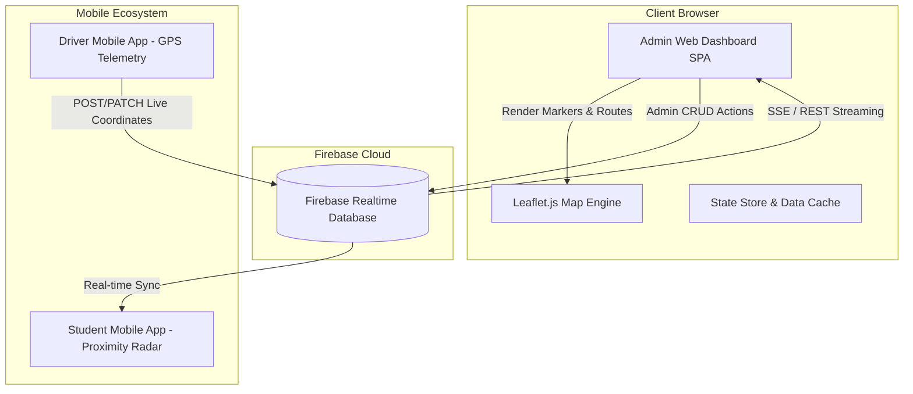

<div align="center">

  

  # 🖥️ UniRide Web Admin Control Center
  ### *Central Transit Operations & Fleet Command Terminal*
  #### **University of Engineering & Technology (UET) — RCET Campus, Gujranwala**

  <p align="center">
    <b>Enterprise-grade web management portal for campus transport officers to monitor real-time bus telemetry, dispatch special shuttles, configure routes and stops, manage drivers, and broadcast campus transit notices.</b>
  </p>

  <p align="center">
    <a href="https://developer.mozilla.org/en-US/docs/Web/JavaScript"></a>
    <a href="https://leafletjs.com"></a>
    <a href="https://firebase.google.com"></a>
    <a href="https://developer.mozilla.org/en-US/docs/Web/CSS"></a>
    <a href="https://openstreetmap.org"></a>
    <a href="../README.md"></a>
  </p>

  <p align="center">
    <a href="#-overview">Overview</a> •
    <a href="#-key-capabilities">Key Features</a> •
    <a href="#-architecture--modules">Modules</a> •
    <a href="#-live-interactive-map">Fleet Radar</a> •
    <a href="#-firebase-realtime-cloud-sync">Cloud Sync</a> •
    <a href="#-local-setup--deployment">Deployment</a> •
    <a href="#-file-structure">File Structure</a>
  </p>

</div>

---

## 📌 Overview

The **UniRide Web Admin Portal** serves as the central mission control for UET RCET's transit authority. It provides transport administrators with a zero-friction, responsive single-page web environment (SPA) to oversee daily campus commute logistics, manage 5 active university bus routes across Gujranwala, monitor live GPS transmissions streamed from driver smartphones, and broadcast real-time delay or weather advisories to thousands of commuting students.

> 📱 **Looking for the Flutter Mobile Application?**  
> Check out the complete [UniRide Mobile App Documentation (Android & iOS)](../README.md).

---

## ✨ Key Capabilities

### 🛰️ 1. Real-Time Fleet Radar (Live Map)
- **High-Definition Interactive Leaflet Map**: Powered by OpenStreetMap with customized UET navy and gold cartographic styling.
- **Dynamic Bus Markers**: Moving bus pins displaying vehicle registration, current speed (km/h), driver name, and active route.
- **Accurate Route Polylines**: Complete GT Road roadway trajectories for all 5 university routes with stop waypoints.
- **Live Filtering**: Focus on specific buses, routes, or filter by operational status (`On Route`, `Idle`, `Maintenance`).

### 🚌 2. Fleet & Bus Management
- Full CRUD operations (Create, Read, Update, Delete) for campus fleet vehicles.
- Real-time occupancy status oversight (`Seats Available`, `Standing Only`, `Bus Full`).
- Direct binding to assigned routes, drivers, and operational shifts.
- Emergency SOS indicator monitoring in case of breakdown or road incident.

### 🛣️ 3. Route & Waypoint Management
- Route directory covering all major corridors across Gujranwala (Chanda Qila, Wapda Town, Peoples Colony, Cantt, Pindi Bypass, Sheikhupura Mor).
- Ordered waypoint management with exact GPS coordinates (Latitude & Longitude).
- Distance calculation, estimated transit durations, and stop amenities.

### 🕒 4. Timetable & Schedule Management
- Configure official university departure times:
  - **Morning Inbound Shifts**: 06:45 AM – 07:45 AM pickup windows.
  - **Campus Arrival**: 08:15 AM at RCET Main Terminal.
  - **Evening Outbound Shifts**: Sharp 04:15 PM campus departures.
- Add and edit custom exam-day or Friday schedules.

### ⚡ 5. Special Shuttle Dispatcher
- Dedicated workflow to schedule ad-hoc special campus transit trips:
  - 🎓 *Exam Special Departures*
  - 🏆 *Sports Gala & Event Shuttles*
  - 🔬 *Late Lab & Project Working Shifts*
  - 🌧️ *Extreme Weather Emergency Shuttles*
- Assign available reserve buses and drivers with instant notification dispatch.

### 👨‍✈️ 6. Driver Staff Administration
- Directory of verified university shuttle drivers.
- Direct contact details, CNIC/license records, and vehicle assignments.
- Real-time connection status indicating which drivers are currently broadcasting live GPS telemetry.

### 📢 7. Emergency Broadcast & Campus Alerts
- Send campus-wide transit bulletins directly to student smartphones:
  - ⚠️ Route diversions and road construction alerts.
  - 🌫️ GT Road heavy winter fog and speed restriction warnings.
  - ⏳ Unforeseen mechanical delay announcements.
- Categorized severity: `Info`, `Warning`, `Emergency`.

---

## 🏗️ Architecture & Modules

The portal is built using high-performance Vanilla ES6+ JavaScript, modular CSS with CSS variables, and Leaflet.js, ensuring zero heavy framework overhead, instant startup times, and seamless execution on any desktop or tablet browser.



---

## 📡 Firebase Realtime Cloud Sync

The Web Admin Portal integrates directly with the Firebase Realtime Database cloud REST API:

- **Database Endpoint**: `https://uniride-app-79177-default-rtdb.firebaseio.com/`
- **Synchronized Nodes**:
  - `/live_buses` — Real-time telemetry, position coordinates, speed, and occupancy.
  - `/routes` — Waypoints, stops, path geometry, and assigned fleet.
  - `/drivers` — Driver roster and contact info.
  - `/timetables` — Schedule matrices for morning and afternoon shifts.
  - `/alerts` — Noticeboard broadcasts pushed to mobile passenger devices.
  - `/special_shuttles` — Ad-hoc dispatch assignments.

---

## 🚀 Local Setup & Deployment

The admin portal is a client-side static web application with no build compilation step required.

### Option 1: Using Python HTTP Server
```bash
# Navigate to the admin portal folder
cd admin_portal

# Launch Python local web server (Port 3000 or 8080)
python -m http.server 3000
```
Open your browser at: `http://localhost:3000`

### Option 2: Using Node.js `npx serve`
```bash
cd admin_portal
npx -y serve . -p 3000
```

### Option 3: VS Code Live Server
1. Open the `admin_portal` folder in VS Code.
2. Right-click [`index.html`](file:///c:/Users/Khadija%27Laptop/Uniridr/admin_portal/index.html) and select **"Open with Live Server"**.

---

## 📁 File Structure

```
admin_portal/
├── index.html            # Main semantic HTML5 single-page application shell
├── styles.css            # Complete design system (Navy/Gold UET palette, responsive grid)
├── app.js                # Core controller: tab router, Leaflet map, CRUD modals, cloud sync
├── data.js               # Fallback offline seed data for buses, routes, drivers, and shifts
├── route_polylines.js    # High-precision road coordinate polylines for Gujranwala GT Road
└── README.md             # Dedicated Admin Portal documentation
```

---

## 🎨 Official Color Palette (UET Brand Alignment)

| Color Token | Hex Code | Visual | Usage |
|---|:---:|:---:|---|
| **Primary Navy** | `#0A2240` | `■` | Sidebar, primary headers, modal titles |
| **Canary Gold** | `#FED136` | `■` | Brand accent, active tabs, highlight chips |
| **Secondary Slate** | `#1D3E6E` | `■` | Card borders, secondary buttons, subheaders |
| **Canvas Ice** | `#F8FAFC` | `■` | Main content canvas and card surfaces |
| **Live Emerald** | `#16A34A` | `■` | Active GPS transmission indicators, on-route badges |
| **Alert Ruby** | `#DC2626` | `■` | Emergency SOS and severe warning badges |

---

## 🔗 Related Documentation

- 📱 [**UniRide Mobile App (Flutter) Full Documentation**](../README.md)
- 🗄️ [**Firebase Security & RTDB Rules**](../database.rules.json)

---

<div align="center">
  <sub>UniRide Transport Operations Terminal • <b>University of Engineering & Technology (UET) RCET Gujranwala</b></sub>
</div>
